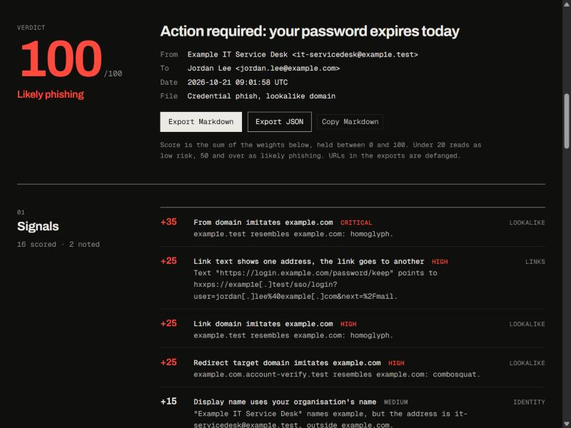
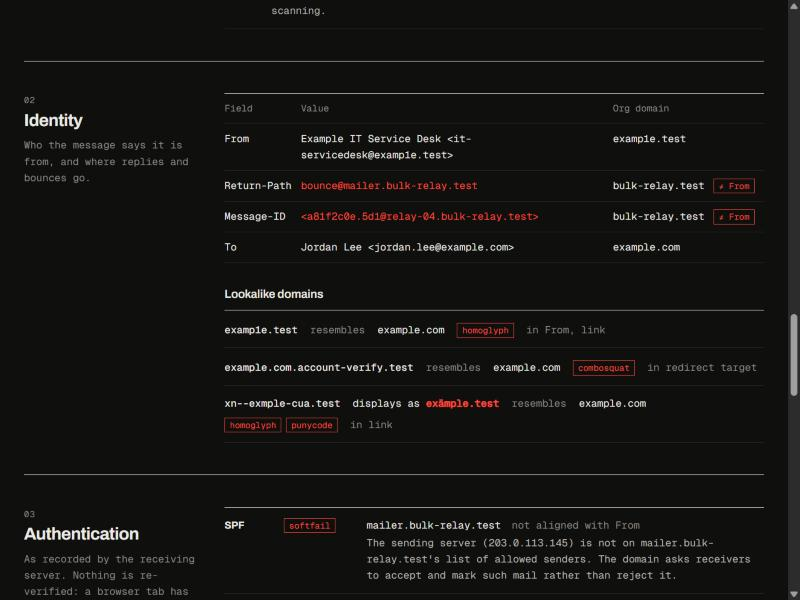
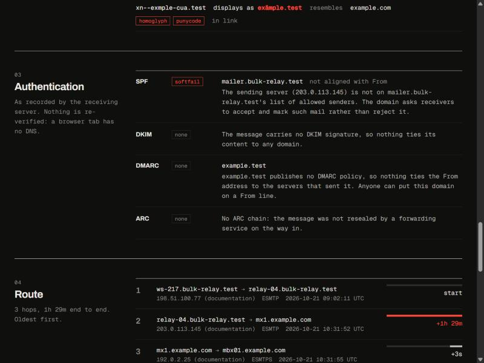
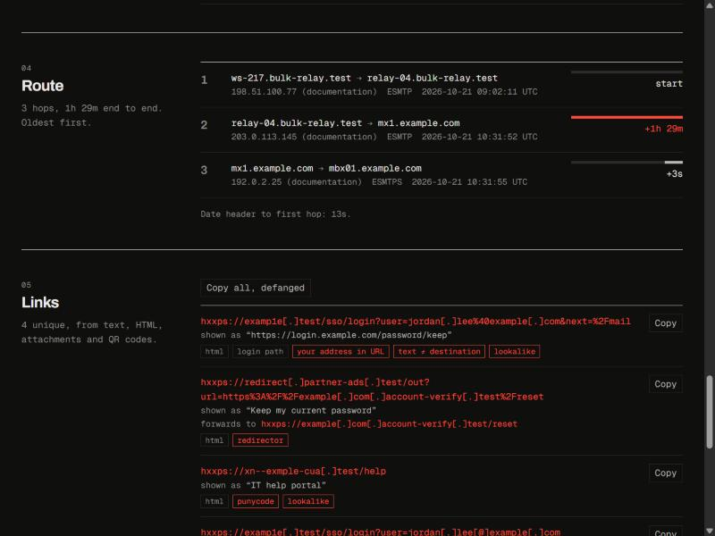
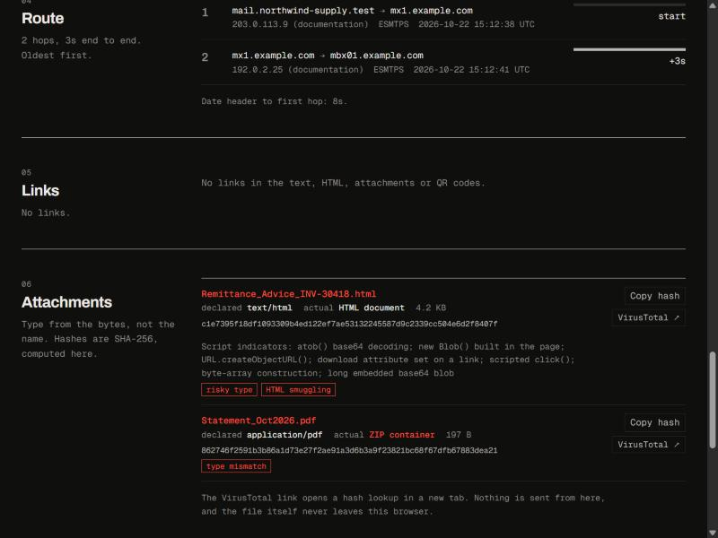
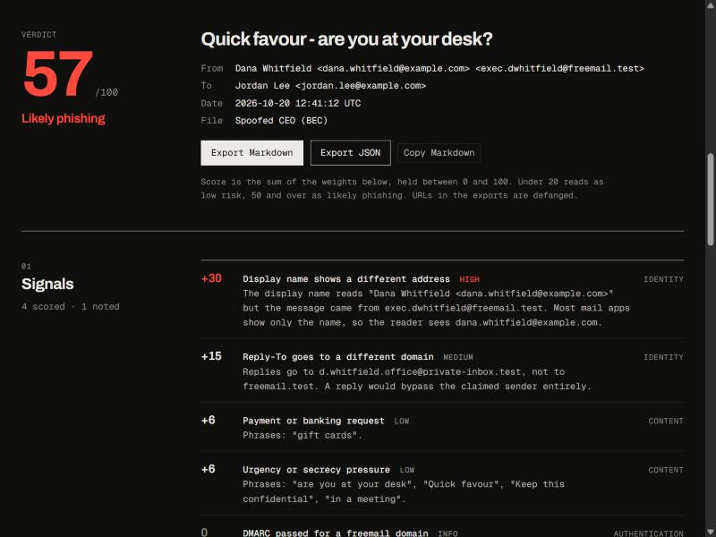
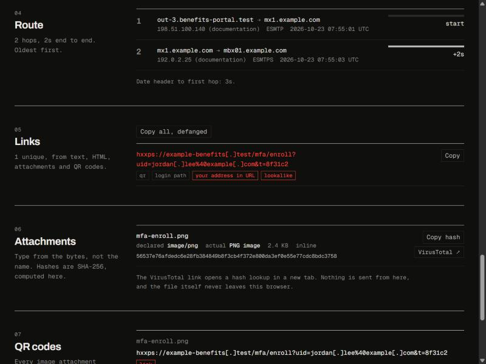
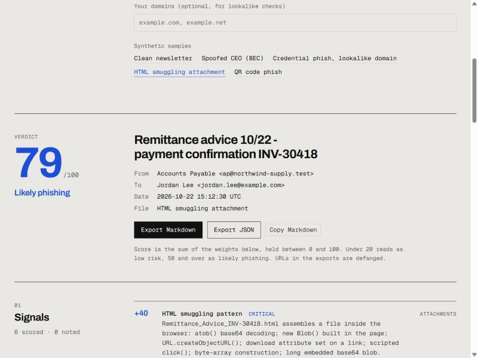
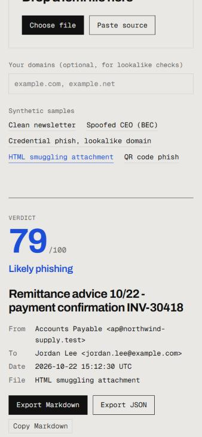

# eml-analyzer

A phishing email analyzer that runs entirely in the browser. Drop in a `.eml` file or paste the raw
source and it reads the message the way an analyst would: the hop-by-hop route, what SPF, DKIM, DMARC
and ARC actually said, who the sender claims to be, where every link really goes, what each attachment
really is, and what any QR code in an image decodes to. Every finding becomes a weighted signal, and
the whole analysis exports as Markdown or JSON.

Nothing leaves the tab. There is no server, no upload and no API call. The message HTML is read for
links and text but never rendered, so remote images and scripts in the message never load. The
VirusTotal button is a plain link to a hash lookup; nothing is sent until the reader clicks it. (The
standalone demo page loads its two typefaces from Google Fonts; the analyzer itself makes no requests.)



## What it checks

| Area | What it does |
| --- | --- |
| Route | Parses every `Received` header into from / IP / by / protocol / time, oldest hop first, with the delay between hops. Flags holds over an hour, clocks that run backwards, and a `Date` header far from the first hop. Labels documentation, private and public IP space. |
| Authentication | Reads `Authentication-Results` (RFC 8601), including Microsoft 365's form with no authserv-id, plus `Received-SPF`, `DKIM-Signature` and the ARC set (`ARC-Seal`, `ARC-Message-Signature`, `ARC-Authentication-Results`, RFC 8617). Produces SPF / DKIM / DMARC / ARC verdicts with the checked domain, whether it aligns with From, and a plain-language explanation. Only the topmost results (the mailbox's own gateway) are trusted. |
| Identity | Lines up From, Sender, Reply-To, Return-Path and Message-ID by organisational domain and marks every one that leaves the From domain. Catches a display name that contains a different email address, a display name that uses the recipient's organisation name from outside it, executive titles and internal department names from external senders, multiple From addresses, and freemail senders. |
| Lookalikes | Compares sender, reply, bounce, link, redirect-target and QR domains against the recipient's domains, the From domain and any domains you enter. Techniques: homoglyphs (confusable-character skeleton covering Cyrillic, Greek, accented Latin, `rn`→`m`, `1`→`l` and similar), punycode (decoded back to what the reader sees), mixed scripts, edit distance (Damerau, transpositions count as one), combosquats (`example-sso.test`, `example.com.login.test`) and TLD swaps. |
| Links | Every URL from the text part, the HTML part (`<a>`, `<area>`, `<form action>`, meta refresh), HTML attachments and QR codes. Shows the real destination next to the visible text and flags text that displays a different domain, shorteners, redirectors (with the forwarded destination unwrapped, including base64), bare IP hosts, punycode, login-style paths, your own address baked into the URL, `javascript:` and `data:` links. Each link has a defanged copy button. |
| Attachments | Sniffs the real type from magic bytes (PDF, ZIP/OOXML, OLE, images, PE, ELF, RAR, 7z, gzip, LNK, OneNote, ISO at offset 0x8001, RTF, CAB, HTML, SVG) and compares it with the extension and the declared MIME type. Flags double extensions, right-to-left override characters, executables, disk images, macro containers and risky types. HTML and SVG attachments are scanned for HTML-smuggling script patterns and offline password forms. SHA-256 via Web Crypto, with a VirusTotal lookup link. |
| QR codes | Every image attachment and every `data:` image in the HTML is decoded with jsQR. A QR code that holds a URL is analysed like any other link, lookalike checks included. |
| Content | Three English phrase families: payment requests, credential lures and urgency or secrecy pressure. Each family counts once. |

## Scoring

Each signal carries a weight. The score is the sum, held between 0 and 100: under 20 reads as
**low risk**, 20 to 49 as **suspicious**, 50 and over as **likely phishing**. Negative weights are
trust signals (an aligned DMARC pass, authenticated bulk mail with `List-Unsubscribe`); weight-0
signals are recorded for the analyst without moving the score. Some examples:

| Signal | Weight |
| --- | --- |
| HTML smuggling pattern in an attachment | +40 |
| From domain imitates a protected domain | +35 |
| Display name shows a different address at your own domain | +30 |
| DMARC failed | +30 |
| Executable or script attachment | +30 |
| Link text shows one domain, the link goes to another | +25 |
| File type does not match its name | +25 |
| QR code that holds a link | +25 |
| Reply-To at a different domain (consumer mailbox) | +15 (+20) |
| DMARC passed, From domain not a freemail provider | −15 |
| Authenticated bulk mail with List-Unsubscribe | −5 |

The full list, with the reason for each, is in [`src/core/analyze.ts`](src/core/analyze.ts).

## Sample corpus

`samples/` holds five synthetic messages, generated by `scripts/make-samples.mjs`. Every domain is a
reserved name (`example.com`, the `.example` and `.test` TLDs; RFC 2606 and RFC 6761), every public IP
is from the documentation ranges (RFC 5737), and the "payloads" are harmless text.

| File | Scenario | Score |
| --- | --- | --- |
| `01-clean-newsletter.eml` | Newsletter through a mailing service. SPF passes for the service, DKIM and DMARC pass for the sender, ARC sealed by the recipient's gateway, inline logo. | 0, low risk |
| `02-ceo-bec.eml` | Display name `Dana Whitfield <dana.whitfield@example.com>` on a freemail account, Reply-To at another domain, gift-card request. Authentication passes, for the freemail provider. | 57, likely phishing |
| `03-credential-phish-lookalike.eml` | `examp1e.test` sender, link text showing `login.example.com` over a lookalike href, a redirector to `example.com.account-verify.test`, a punycode help link, SPF softfail, Microsoft-style results with `compauth=fail`, a 1 h 29 m hold between relays. | 100, likely phishing |
| `04-html-smuggling.eml` | Vendor account with passing SPF/DKIM/DMARC. An `.html` attachment that rebuilds a file with `atob` / `Blob` / `createObjectURL` / `download`, and a `.pdf` that is really a ZIP. | 79, likely phishing |
| `05-qr-phish.eml` | MFA re-enrolment lure with no clickable links; the URL is in an inline PNG QR code pointing at `example-benefits.test`. | 90, likely phishing |

## Use it

```bash
npm install
npm run dev        # demo at http://localhost:5178
npm test           # Vitest: core units and the sample corpus
npm run build      # library into dist/
npm run samples    # regenerate samples/
```

### In a React or Next.js app

The package has a framework-agnostic core and a React component. The React entry is marked
`"use client"`, so it mounts straight into a Next.js App Router page.

```tsx
import { EmlAnalyzer } from "@saafirhale/eml-analyzer/react";
import "@saafirhale/eml-analyzer/styles.css";

export default function Page() {
  return <EmlAnalyzer protectedDomains={["example.com"]} />;
}
```

Props: `samples` (one-click sample buttons, each with a lazy `load()`), `protectedDomains`,
`decodeImage` (custom image decoder for QR scanning) and `className`.

The stylesheet reads the host page's tokens, `--bg`, `--fg`, `--fg2`, `--muted`, `--line`,
`--accent`, `--font-display` and `--font-mono`, so it follows the host's light and dark themes. On a
page without them it falls back to a dark palette with a red accent.

### The core alone

```ts
import { analyzeEml, toMarkdown, toJSON } from "@saafirhale/eml-analyzer";

const result = await analyzeEml(fileOrBytesOrString, { protectedDomains: ["example.com"] });
result.score;       // 0–100
result.band;        // "low" | "suspicious" | "high"
result.signals;     // every finding with weight, severity and detail
toMarkdown(result); // defanged report for a ticket
```

Under Node there is no `createImageBitmap`, so pass `decodeImage` to scan QR codes (the tests use
pngjs) or `skipQr: true`. Everything else, SHA-256 included, works the same in Node 20+.

## Limits, stated plainly

- **No DNS.** A browser tab cannot query SPF, DKIM or DMARC records, so the authentication verdicts
  are the ones the receiving server recorded. Anyone can write an `Authentication-Results` header
  into a message; the analyzer trusts only the topmost one and those with the same authserv-id.
- **Organisational domain is approximated** as the last two labels, or three under common
  second-level suffixes such as `co.uk`. There is no Public Suffix List download.
- **HTML is read with tolerant regular expressions**, not a DOM. That is deliberate (nothing is ever
  parsed into a live document) and works identically in a worker or under Node, at the cost of
  missing links that only exist after script runs.
- **Content cues are English phrases.** They are weak signals by design and weigh 6 points each.
- **Lookalike checks compare against domains the message itself names** (recipients and From) plus
  any you enter. There is no built-in brand list.

## Layout

```
src/core/     analyzer (no framework dependencies)
src/react/    EmlAnalyzer component and styles.css
demo/         Vite demo page with the host site's tokens
samples/      synthetic .eml corpus
scripts/      sample generator, library build
test/         Vitest suites
docs/         screenshots from the browser preview
```

## Screenshots

| | |
| --- | --- |
|  |  |
|  |  |
|  |  |
|  |  |
